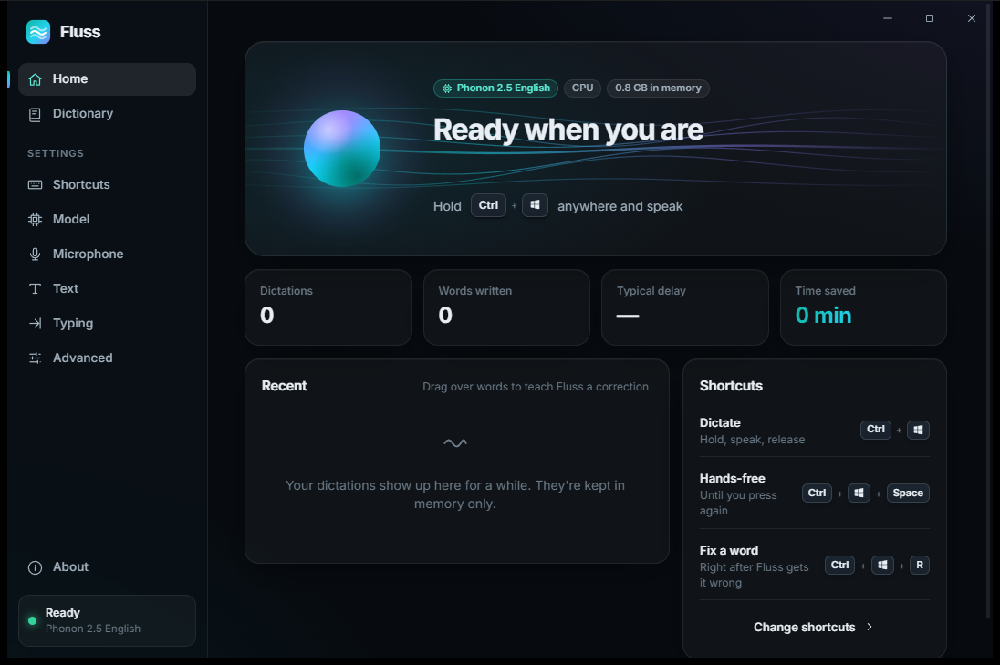
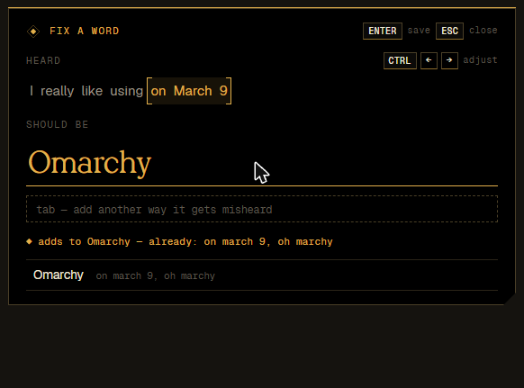

# Fluss

**Fast, private, local dictation for Windows.** Hold <kbd>Ctrl</kbd>+<kbd>Win</kbd>, speak, let go. Your words appear wherever your cursor is.

*Fluss* is German for river: speech in, text out, nothing in the way.



<p align="center"></p>
<p align="center"></p>

- **Runs on your machine.** The speech models run locally (CPU or GPU). No account, no cloud, no audio leaves your PC, unless you choose a custom endpoint.
- **Built for latency.** Text is typed in one batch. A phrase that ended before you let go is usually already transcribed, so the text appears almost instantly. Model loading runs at low priority and never stalls your apps.
- **Lightweight.** A Rust background app (~30 MB plus the model) with a native overlay. The settings window only runs while it's open.

## Features

- **Push-to-talk** (<kbd>Ctrl</kbd>+<kbd>Win</kbd>) and **hands-free** (<kbd>Ctrl</kbd>+<kbd>Win</kbd>+<kbd>Space</kbd>, or double-tap) with a live preview while you speak. Every shortcut can be changed, including mouse buttons and single keys.
- **Pre-roll and post-roll buffers** (default 0.5 s each, adjustable). Words you start saying just *before* pressing the shortcut, or finish just *after* letting go, are still captured.
- **Continuation that understands the seam.** If you dictate again into the same text field without touching anything, Fluss re-decodes the end of the previous audio together with the new audio, so the model decides how the two connect. A period it guessed too early becomes a comma, and the next word stays lowercase. The same happens between pauses in hands-free mode.
- **One-second corrections.** Right after the model gets a word wrong, press <kbd>Ctrl</kbd>+<kbd>Win</kbd>+<kbd>R</kbd>. The popup is already filled in with *what you just said*. Fluss works out the whole spoken chunk from timing, audio energy and confidence, so a misheard "Omarchy" fills in as "on March 9", not "9". Your cursor starts in **Should be**: type the right spelling and press Enter. The rule is saved and the text you just dictated is fixed in place.
  - <kbd>Ctrl</kbd>+<kbd>←</kbd>/<kbd>→</kbd> adjusts the chunk.
  - <kbd>Tab</kbd> adds more ways the word gets misheard.
  - Typing a word you already have shows its existing variants.
  - Existing rules are searchable from both the popup and Settings.
- **Text layer**: spoken punctuation ("comma", "new line", "question mark", …), filler removal (um/uh), all-lowercase mode, optionally no final period, and your dictionary. Dictionary words are also passed to the model as hotwords.
- **Models**
  | Model | Size | Runs on | Languages |
  |---|---|---|---|
  | **Phonon 2.5 English** (default) | 158 MB | CPU (AVX-512/AVX2) | English |
  | Phonon 2.5 Multilingual | 170 MB | CPU | 25 European |
  | Parakeet TDT 0.6B v3 | 2.5 GB | GPU (DirectML, any DX12 GPU) or CPU | 25 European |
  | Custom endpoint | — | anywhere | depends |

  The custom endpoint is any OpenAI-compatible `POST /v1/audio/transcriptions` server, local or online: OpenAI, Groq, whisper.cpp server, speaches, `fermion serve`, and others.
- **Memory control.** Keep the model loaded forever (the default), unload it after *N* idle minutes (20 by default), or load it only while dictating. If a dictation starts while the model is asleep, audio keeps recording while the model loads, and the overlay shows the progress.
- **Tray, autostart, onboarding**, light and dark themes, reduced motion, start/stop sounds, in-memory history.
- **A full CLI** for status, settings, dictionary, models, transcription and diagnostics.

## Install

Download `Fluss_x.y.z_x64-setup.exe` from [Releases](https://github.com/mflRevan/fluss/releases) or [the website](https://fluss-mauve.vercel.app) and run it. No admin rights are needed. Onboarding walks you through choosing a microphone and a model, then lets you try it out.

## Command line

```text
fluss status [--watch]           what Fluss is doing (model, mic, shortcuts, latency)
fluss config list|get|set|reset  every setting, e.g. fluss config set audio.preroll_ms 300
fluss rules add Omarchy --heard "on march 9"
fluss rules list [query] | remove | test "some text"
fluss model list|use|install|load|unload
fluss transcribe meeting.wav
fluss dictate start|stop|cancel
fluss history | logs -f | devices | doctor | autostart on|off
fluss ipc <method> [json]        call any daemon method directly
```

Every command has `--help`, and `--json` is available for scripts.

## How it works

```
 hotkey hook ─┐                     ┌─ engine thread ── Phonon (managed `fermion serve`, isolated Python via uv)
 microphone ──┼─▶ controller ──────▶│                ── Parakeet (ONNX Runtime in-process, DirectML)
 IPC (CLI/UI)─┘   segmenter,        └─                ── custom endpoint (HTTP)
                  previews, seams,
                  text pipeline ───▶ injector (SendInput / paste) ─▶ focused app
                                 └─▶ overlay (layered window, tiny-skia)
```

- `crates/fluss-core`: config, hotkeys, dictionary, text pipeline, continuation repair, chunk detection, IPC protocol. Pure logic, unit-tested.
- `crates/fluss-daemon`: the background app (Win32 hooks, cpal audio, engines, overlay, tray, IPC server).
- `crates/fluss-cli`: the `fluss` command.
- `ui/`: the settings app, onboarding and rule popup (Tauri 2 + Svelte 5). It is a separate process that runs only while a window is open.

A few design details:

- **Live preview.** The open phrase is re-decoded every 450 ms. Previews are always dropped in favour of final decodes, so they can never delay text.
- **Phrase ends.** A pause (700 ms by default) or 28 s closes a phrase.
- **Releasing the shortcut.** If you had already stopped talking, the last preview usually covers the whole phrase and is used directly as the final text.
- **GPU decoding.** DirectML compiles a fast graph for only one input shape, so Fluss pads the encoder input to one fixed window and masks the padding: about 40 ms per phrase on the GPU.
- **Continuation safety.** Fluss tracks the focused window and control, plus an "input epoch" bumped by any key or click that isn't Fluss's own. It only edits text you haven't touched.

## Building

Requirements: Rust (stable), Node 22, Windows 10/11 with the MSVC build tools.

```powershell
powershell -File scripts\check.ps1             # what CI runs, plus the UI build (-Quick: Rust tests only)
powershell -File scripts\install-hooks.ps1     # run the quick check before every git push
cd ui; npm ci; npm run dev                     # settings UI in a browser with a mock backend
powershell -File scripts\build-installer.ps1   # release binaries + NSIS installer
```

CI on GitHub only runs the cached Rust tests, and only when Rust code changes. The full cross-platform
build (UI + Tauri on Windows, Linux and macOS) is manual: Actions → CI → *Run workflow*.

The website (`site/`, live at https://fluss-mauve.vercel.app) is static HTML/CSS/JS with no build step.
Its "Try with your mic" runs Phonon 2.5 English in the browser on WebGPU: the page downloads the model from
Hugging Face once and rebuilds the weights for ONNX Runtime Web from it; only weight-less graphs are hosted
(`site/phonon/`, made by [`scripts/phonon-web/build.py`](scripts/phonon-web/build.py)).

Releasing: push a version tag (`git tag v0.1.0; git push origin v0.1.0`). The *Release* workflow builds the installer,
publishes a GitHub release and redeploys the website to Vercel (needs the `VERCEL_TOKEN` repo secret).

Design language: [`docs/DESIGN.md`](docs/DESIGN.md) — black and gold, Licht Serif / Geist / Geist Mono.

Developer helpers:

- `fluss-daemon --render-overlay <dir>` renders every overlay state to PNG.
- `fluss-daemon --bench <model> <file.wav>` times decodes.
- `FLUSS_TEST_SINK=<file>` makes the daemon "type" into a file, for end-to-end tests that never touch the desktop.
- Setting the microphone device to `file:<path.wav>` streams a WAV as if it were a microphone.
- `FLUSS_LOG=debug` turns on debug logging.

macOS and Linux: the core, engines, CLI and settings app build there. Global shortcuts, text insertion and the overlay are currently Windows-only.

## Credits

- [Phonon 2.5](https://huggingface.co/FermionResearch/Phonon-2.5-English) by Fermion Research (CC-BY-4.0).
- [Parakeet TDT 0.6B v3](https://huggingface.co/nvidia/parakeet-tdt-0.6b-v3) by NVIDIA (CC-BY-4.0), ONNX export by [istupakov](https://huggingface.co/istupakov/parakeet-tdt-0.6b-v3-onnx).
- [Licht Serif](https://zon.sh/licht) by zon.sh (used with permission); [Geist and Geist Mono](https://vercel.com/font) by Vercel (OFL).
- Built with [Tauri](https://tauri.app), [Svelte](https://svelte.dev), [ONNX Runtime](https://onnxruntime.ai), [cpal](https://github.com/RustAudio/cpal) and [tiny-skia](https://github.com/RazrFalcon/tiny-skia).

MIT licensed.
